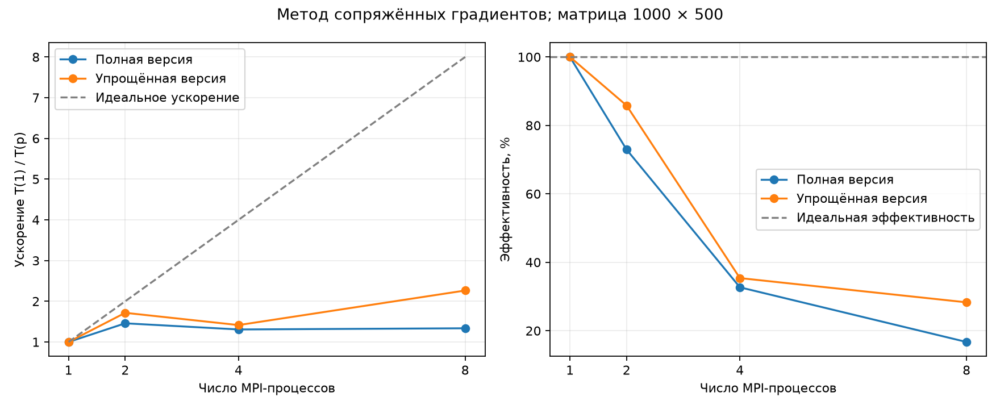
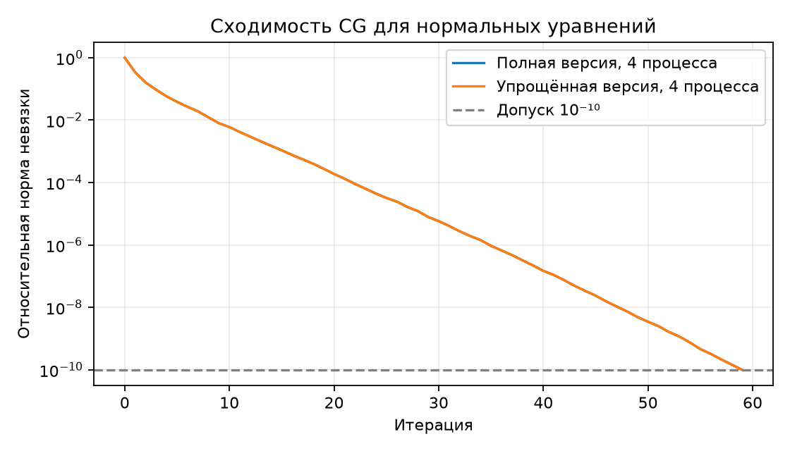
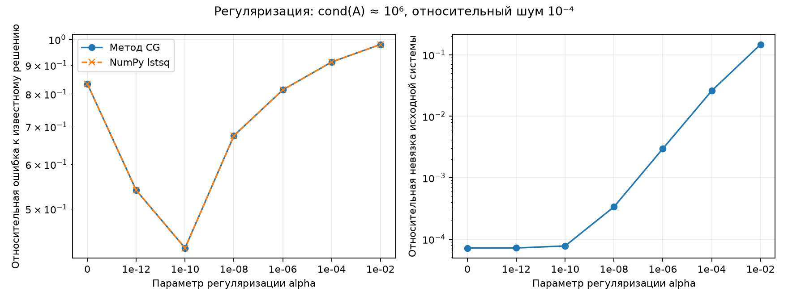

# Лабораторная работа №3

## Параллельная реализация метода сопряжённых градиентов для решения СЛАУ

Исмаилов Самир Рамазан Оглы ПИН-м-о-26-1

## 1. Цель и постановка задачи

Цель — реализовать две параллельные версии метода сопряжённых градиентов, проверить точность и сравнить их масштабируемость. Дополнительно исследуются регуляризация Тихонова и ранняя остановка.

В задании предусмотрена прямоугольная матрица `A` размера `M × N`, в том числе `1000 × 500`. Поэтому решается задача наименьших квадратов:

$$\min_x \|Ax-b\|_2^2.$$

Для применения метода сопряжённых градиентов используются нормальные уравнения:

$$(A^T A)x=A^T b.$$

Матрица `A.T @ A` явно не создаётся. Её действие на вектор вычисляется как `A.T @ (A @ p)`. Это CG для нормальных уравнений, также известный как подход CGNR. Для полного столбцового ранга `A` матрица нормальных уравнений симметрична и положительно определена. При зависимых столбцах положительная регуляризация обеспечивает положительную определённость.

Для дополнительного задания используется функционал

$$\min_x \bigl(\|Ax-b\|_2^2+\alpha\|x\|_2^2\bigr),\qquad \alpha\ge0,$$

поэтому оператор имеет вид `H(p) = A.T @ (A @ p) + alpha * p`. Параметр `alpha` добавляется непосредственно к диагонали нормальных уравнений; квадрат параметра в этой реализации не используется.

## 2. Формулы итерационного метода

Начальное приближение `x₀=0`. Обозначим `c=A.T @ b`, `H=A.T @ A + alpha*I`. Вектор `r` в коде — **невязка нормальных уравнений** `c-Hx`, длина которого равна `N`. Он отличается от невязки исходной системы `b-Ax` длины `M`.

Начальные значения: `r₀=c`, `p₀=r₀`, `rho₀=r₀.T @ r₀`.

На итерации k:

$$q_k=H p_k,\qquad t_k=\frac{r_k^T r_k}{p_k^T q_k},$$

$$x_{k+1}=x_k+t_k p_k,\qquad r_{k+1}=r_k-t_k q_k,$$

$$\beta_k=\frac{r_{k+1}^T r_{k+1}}{r_k^T r_k},\qquad p_{k+1}=r_{k+1}+\beta_k p_k.$$

Критерий остановки:

$$\|r_k\|_2\le\max(\mathrm{atol},\ \mathrm{tol}\,\|r_0\|_2).$$

По умолчанию `tol=1e-10`, `atol=1e-12`, максимальное число итераций — `4N`. В точной арифметике CG для положительно определённой матрицы завершился бы не более чем за `N` шагов, но при вычислениях с плавающей точкой этот предел не является гарантией достижения заданной точности. Нулевой начальной невязке соответствует завершение без итераций. Неположительное `p.T @ q` и нечисловые значения приводят к диагностическому завершению, а не к делению на некорректный знаменатель.

## 3. Полная версия

Матрица распределена по строкам. Вместе с блоком `local_A` каждый процесс получает соответствующую часть `b`. Векторы неизвестных `x`, `r`, `p`, `q` делятся по компонентам отдельно, поскольку их длина равна `N`, а число строк матрицы — `M`.

| Объект | Общий размер | Постоянное хранение на процессе |
|---|---|---|
| A | M × N | local_M × N |
| b | M | local_M |
| x, r, p, q | N каждый | local_N каждый |

Размеры блоков и смещения рассчитываются отдельно для `M` и `N`. Сначала используются `Bcast` для размеров и `Scatterv` для матрицы и правой части. Нулевое начальное приближение создаётся локально: передавать одинаковые нули от корня не требуется.

Порядок вычислений:

1. Начальный `x` собирается через `Allgatherv`. Процессы вычисляют локальные части `b-Ax`.
2. Каждый процесс умножает `local_A.T` на локальную невязку. Частичные вклады длины `N` суммируются и распределяются через `Reduce_scatter` с `MPI.SUM`. Получается локальная часть `r`.
3. В цикле через `Allgatherv` собирается полный `p`. Вычисляется `u=local_A @ p`.
4. Вклады `local_A.T @ u` суммируются и распределяются через `Reduce_scatter`; к локальному результату добавляется `alpha * p`.
5. Скалярные произведения `r.T @ r` и `p.T @ q` суммируются через `Allreduce`. После этого обновляются локальные векторы.
6. После окончания цикла итоговый `x` собирается на процессе 0 через `Gatherv`.

Основные рабочие векторы распределены, но временный полный `p` и буфер частичного вклада `A.T @ u` имеют длину `N` на каждом процессе. Поэтому эта реализация не устраняет полностью затраты памяти порядка `N` на ранг. Процесс 0 также хранит исходные данные для чтения и проверки.

## 4. Упрощённая версия

Матрица и `b` распределены по строкам так же, но полные векторы `x`, `r`, `p`, `q` хранятся на каждом процессе.

Каждый процесс вычисляет `u=local_A @ p`, затем `local_A.T @ u`. Операция `Allreduce` с `MPI.SUM` складывает частичные векторы и возвращает полный `q` всем рангам. Остальные действия выполняются локально над одинаковыми полными векторами.

Так как `r` и `p` совпадают на всех процессах, их скалярные произведения вычисляются локально и **не суммируются повторно между рангами**. Иначе результат был бы ошибочно умножен на число процессов.

| Характеристика цикла | Полная версия | Упрощённая версия |
|---|---|---|
| Рабочие x, r, p, q | Разделены по компонентам | Полностью на каждом ранге |
| Получение p для умножения | Allgatherv | Уже доступен |
| Получение q | Reduce_scatter | Allreduce |
| Две скалярные редукции | Нужны | Не нужны |
| Обновление векторов | Локальная часть | Полный вектор |

Упрощённая версия выполняет меньше коллективных вызовов на шаг, но дублирует векторные вычисления и хранение. Число вызовов само по себе не определяет стоимость: важны размер сообщения, алгоритм MPI и архитектура компьютера.

## 5. Неравномерное разбиение и файлы

Для длины `L` и числа процессов `p` вычисляются `base, extra = divmod(L, p)`. Первые `extra` рангов получают `base+1` элемент, остальные — `base`. Массив `counts` соответствует `rcounts` в задании, `offsets` — `displs`.

Например, при `M=7`, `N=5`, `p=4`:

| Ранг | Строки A и элементы b | Компоненты x, r, p, q в полной версии |
|---:|---|---|
| 0 | 0–1 | 0–1 |
| 1 | 2–3 | 2 |
| 2 | 4–5 | 3 |
| 3 | 6 | 4 |

При передаче матрицы количества и смещения строк умножаются на `N`. Для векторов используются их собственные количества и смещения. Если данных меньше, чем процессов, пустой блок участвует в коллективных вызовах с нулевой длиной и даёт нулевой вклад.

| Файл | Назначение |
|---|---|
| `src/cg_full.py` | Полная версия CG |
| `src/cg_simple.py` | Упрощённая версия CG |
| `src/common.py` | Ввод, проверка данных, разбиение, эталон и сбор результата |
| `scripts/generate_data.py` | Генератор системы с известным решением |
| `scripts/benchmark.py` | Замеры масштабируемости и графики |
| `scripts/studies.py` | Регуляризация и ранняя остановка |

Основной набор `data/` содержит матрицу `1000 × 500`; набор `data/uneven/` — матрицу `7 × 5`. В `in.dat` записаны сначала `N`, затем `M`. В `AData.dat` хранится матрица, в `bData.dat` — правая часть. Генератор использует `A = rng.normal(size=(M,N))/sqrt(M)` и `b=A @ x_true`; известный `x_true` сохраняется в `xTrue.dat`. Основной seed равен `42`, дополнительный — `43`.

## 6. Проверка корректности

На процессе 0 результат сравнивается с `np.linalg.lstsq(A, b, rcond=None)[0]`. Для `alpha>0` эталон вычисляется через расширенную задачу:

```text
[ A                 ] x ≈ [ b ]
[ sqrt(alpha) · I   ]     [ 0 ]
```

Это позволяет проверить ту же регуляризованную задачу без явного формирования нормальной матрицы.

Перед подготовкой отчёта пройдены **13 автоматизированных тестов** (служебные тесты в сдаваемый проект не включены), включая реальные MPI-запуски на 1, 2, 4 и 8 процессах. Внутри MPI-тестов обе версии проверяются на нескольких системах, с регуляризацией и без неё.

| Проверка | Результат |
|---|---|
| Системы 1×1, 3×2, 7×5, 17×9, в том числе с шумом | Совпадение с lstsq в пределах rtol=1e-8, atol=1e-9 |
| Система с единичной матрицей | Точное решение за одну итерацию |
| Нулевая правая часть | Нулевое решение без итераций |
| Зависимые столбцы при alpha=0,1 | Совпадение с регуляризованным эталоном |
| Недостаточный maxiter | Сообщение о недостижении допуска |
| Процессов больше, чем строк или компонент вектора | Корректная работа с пустыми блоками |
| Неверные размеры, отрицательный alpha, NaN в допуске | Согласованная ошибка на всех рангах |
| Отсутствующие файлы | Завершение без зависания |

Закрытые тесты преподавателя не запускались.

Основная система во всех замерах решена за **59 итераций**. Относительная ошибка к `lstsq` составила около `3,85·10⁻¹⁰`, относительная невязка исходной системы — `1,66·10⁻¹⁰`, а независимо пересчитанная невязка нормальных уравнений — `9,83·10⁻¹¹` относительно `||A.T @ b||`. Разные порядки суммирования MPI дают небольшие различия последних разрядов.

## 7. Производительность и масштабируемость

### 7.1. Условия измерений

Эксперимент выполнен на одном компьютере с Intel Core i5-12400F: 6 физических ядер, 12 логических процессоров. Среда: Windows 11, Python 3.12.14, NumPy 2.3.5, mpi4py 4.1.2, Intel MPI 2021.18.1. Код использует стандартные операции MPI; локальная проверка выполнена с Intel MPI, а запуск с Open MPI или MPICH требует соответствующего окружения и отдельно здесь не проверялся.

Размер системы — `1000 × 500`, `alpha=0`, `tol=1e-10`, `atol=1e-12`. Локальная многопоточность NumPy ограничена переменными `OMP_NUM_THREADS`, `OPENBLAS_NUM_THREADS`, `MKL_NUM_THREADS`, установленными в `1`.

Для каждой версии и числа процессов выполнены один прогрев и пять измерений; результат — медиана. Перед циклом вызывается `Barrier`. Время измеряется через `MPI.Wtime`, после цикла берётся максимум среди рангов.

**В интервал входит только итерационный цикл:** матрично-векторные операции, обмены внутри итераций, скалярные произведения, обновления векторов и проверка остановки. Чтение, проверка и распределение входа, инициализация, расчёт начальной невязки, финальный сбор x и сравнение с lstsq находятся вне интервала. Поэтому таблица не показывает полное время запуска программы.

Для каждой версии используется её собственное время на одном MPI-процессе:

$$S(p)=\frac{T(1)}{T(p)},\qquad E(p)=\frac{S(p)}{p}.$$

Эффективность в таблице и на графике показана в процентах. База здесь — та же MPI-реализация при p=1, а не последовательный `lstsq`.

### 7.2. Результаты

| Процессы | Полная, мс | Упрощённая, мс | S полной | S упрощённой | E полной, % | E упрощённой, % |
|---:|---:|---:|---:|---:|---:|---:|
| 1 | 10,3968 | 7,8642 | 1,000 | 1,000 | 100,00 | 100,00 |
| 2 | 7,1276 | 4,5821 | 1,459 | 1,716 | 72,93 | 85,81 |
| 4 | 7,9520 | 5,5568 | 1,307 | 1,415 | 32,69 | 35,38 |
| 8 | 7,7778 | 3,4738 | 1,337 | 2,264 | 16,71 | 28,30 |



Упрощённая версия быстрее полной во всех исследованных конфигурациях. На восьми процессах её время меньше примерно в `2,24` раза, чем у полной. Её наибольшее измеренное ускорение — `2,264`, эффективность — `28,30%`. Полная версия достигла наибольшего ускорения `1,459` на двух процессах.

В данном размере длина рабочих векторов всего `500`, поэтому их дублирование относительно недорого. Зато полная версия на каждой итерации выполняет Allgatherv, Reduce_scatter и две скалярные редукции. Упрощённая обходится одной векторной Allreduce. Это объясняет преимущество упрощённого варианта в данном эксперименте.

Графики не монотонны: увеличение p от двух до четырёх ухудшило время обеих версий. Результаты зависят от задержек обменов, планирования процессов, пропускной способности памяти и текущей нагрузки. Например, пять измерений упрощённой версии на четырёх процессах лежали примерно в диапазоне `2,32–5,79 мс`, поэтому различия соседних конфигураций не стоит трактовать как универсальную закономерность. При восьми процессах также используются логические потоки сверх шести физических ядер.

Исходные времена, число итераций и ошибки сохранены в [raw_timings.json](report/raw_timings.json), сводная таблица — в [performance.csv](report/performance.csv).

### 7.3. Сходимость



На графике показана величина `||r_k|| / ||r_0||` на четырёх процессах. Кривые двух версий практически совпадают: они используют один математический алгоритм и одинаковый допуск, различается организация данных и обменов. Пунктир — порог `10⁻¹⁰`.

## 8. Дополнительное задание

### 8.1. Регуляризация Тихонова

Для эксперимента создана матрица `80 × 40` с сингулярными числами от `1` до `10⁻⁶`, поэтому `cond(A)≈10⁶`. Известен вектор `x_true`. К правой части `A @ x_true` добавлен шум с относительной нормой `10⁻⁴`. Seed равен `2026`.

Для каждого alpha упрощённая версия запускается с одним процессом через `MPI.COMM_SELF`, с `tol=1e-13`, `atol=0`, `maxiter=8000`. Эталон — регуляризованный `lstsq` через расширенную систему.

| alpha | Итерации | Относительная ошибка к x_true | Относительная невязка Ax-b |
|---:|---:|---:|---:|
| 0 | 1097 | 0,8336 | 7,1642·10⁻⁵ |
| 10⁻¹² | 1032 | 0,5397 | 7,1814·10⁻⁵ |
| 10⁻¹⁰ | 497 | 0,4261 | 7,7492·10⁻⁵ |
| 10⁻⁸ | 227 | 0,6746 | 3,3536·10⁻⁴ |
| 10⁻⁶ | 93 | 0,8133 | 2,9624·10⁻³ |
| 10⁻⁴ | 43 | 0,9116 | 2,5872·10⁻² |
| 10⁻² | 19 | 0,9794 | 1,4684·10⁻¹ |



Среди проверенных значений наименьшая ошибка к известному решению получена при `alpha=10⁻¹⁰`: около `0,426` вместо `0,834` без регуляризации. Это улучшение для выбранной системы, но не восстановление решения с высокой точностью. Слишком большая регуляризация увеличивает смещение решения и ухудшает согласование с правой частью.

С ростом alpha число итераций уменьшается. При этом малая невязка нормальных уравнений не гарантирует малую ошибку x: для alpha=0 относительная невязка нормальных уравнений около `5,4·10⁻¹⁴`, но ошибка к x_true — `0,834`. Шум усиливается в направлениях малых сингулярных чисел.

Даже без явного построения A.T @ A обусловленность нормальной задачи при alpha=0 примерно равна `cond(A)²`, то есть порядка `10¹²`. В регуляризованном опыте относительные отличия CG от соответствующего lstsq достигали примерно `2,83·10⁻⁵`, несмотря на малый критерий остановки. Это показывает ограниченность остановки только по нормальной невязке на плохо обусловленных задачах. Утверждать, что решение имеет 13 верных знаков из-за tol=1e-13, нельзя.

Параметр в опыте выбран по известному x_true, которое в реальной задаче обычно неизвестно. Поэтому найденный alpha не является универсальной рекомендацией. Данные сохранены в [regularization.csv](report/regularization.csv) и [studies.json](report/studies.json).

### 8.2. Ранняя остановка

На основной системе `1000 × 500` сравниваются два режима упрощённой версии на одном процессе: обычный допуск и ограничение N итерациями без положительного допуска (`tol=atol=0`). Выполнены один прогрев и пять измерений, показана медиана.

| Режим | Итерации | Время цикла, мс | Ошибка к lstsq | Невязка Ax-b относительно b |
|---|---:|---:|---:|---:|
| Остановка по допуску | 59 | 8,8253 | 3,8517·10⁻¹⁰ | 1,6631·10⁻¹⁰ |
| Ограничение N=500 | 500 | 79,6296 | 4,3108·10⁻¹⁵ | 1,5297·10⁻¹⁵ |

Ранняя остановка уменьшила время примерно в `9,02` раза, сохранив точность порядка `10⁻¹⁰`. Дополнительные итерации довели ошибку до уровня округления, но такой результат не всегда нужен на практике. Во втором режиме код вернул причину `maxiter`, поскольку задан нулевой допуск; это не означает, что полученное приближение неточно. Этот опыт сравнивает точность и работу цикла, а не успешное достижение нулевого допуска.

На системе с шумом слишком длительное решение нерегуляризованной задачи может усиливать влияние шума; этот эффект отдельно по числу итераций здесь не исследовался. Данные опыта остановки: [early_stopping.csv](report/early_stopping.csv).

## 9. Воспроизведение

Команды выполняются из корня проекта при установленном MPI:

```bash
python -m pip install -r requirements.txt
mpiexec -n 4 python src/cg_full.py
mpiexec -n 4 python src/cg_simple.py
mpiexec -n 4 python src/cg_full.py --data-dir data/uneven
mpiexec -n 4 python src/cg_simple.py --alpha 0.0001
python scripts/benchmark.py
python scripts/studies.py
```

`benchmark.py` ограничивает потоки NumPy в дочерних процессах сам. Перед запуском `studies.py` в условиях данного эксперимента нужно задать `OMP_NUM_THREADS=1`, `OPENBLAS_NUM_THREADS=1`, `MKL_NUM_THREADS=1`. Например, в PowerShell:

```powershell
$env:OMP_NUM_THREADS = '1'
$env:OPENBLAS_NUM_THREADS = '1'
$env:MKL_NUM_THREADS = '1'
python scripts/studies.py
```

Повторные запуски обновляют графики и таблицы; значения в тексте отчёта после этого нужно сверить с новыми измерениями. Лекционные программы 3-1 и 3-2 отдельно не предоставлены; описанная реализация следует формулам CG для нормальных уравнений и требованиям к двум способам хранения векторов.

## 10. Выводы

Реализованы обе версии CG с неравномерным разбиением, проверкой через lstsq, регуляризацией и остановкой по норме невязки. На основной системе обе версии достигли допуска за 59 итераций.

На выбранном размере упрощённая версия оказалась быстрее за счёт меньшего числа коллективных обменов. Рост числа процессов дал ограниченное ускорение и снижение эффективности. Полная версия уменьшает постоянное хранение рабочих векторов на ранге, но в данной реализации сохраняет временные буферы длины N.

Для плохо обусловленных задач регуляризация уменьшила влияние шума при подходящем alpha. При этом малая нормальная невязка не гарантирует точное восстановление x. Для более сложных задач могут понадобиться предобусловливание и методы, лучше сохраняющие численную устойчивость. Представленная реализация использует плотные массивы, хранит исходную матрицу на корне для ввода и проверки и не является готовым решателем для очень больших разреженных систем.
